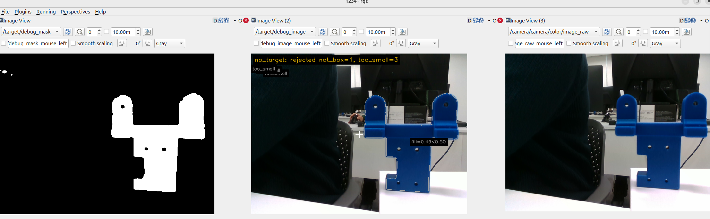
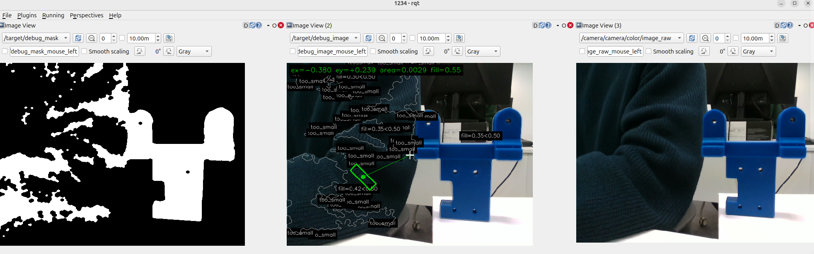
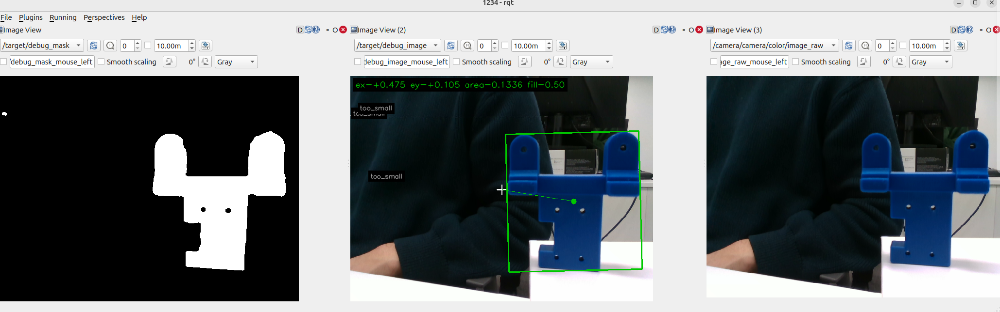
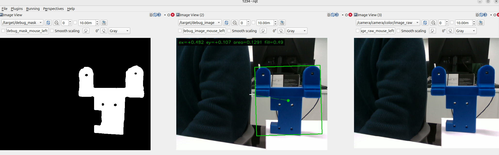

# 모듈 3 추가 과제 보고서

한지훈 (@polarnight1212)

이번 과제는 팀 프로젝트에서 쓰던 비전 노드(`perception_node`)를 그대로 가져와서, Raw Image·Mask·검출 결과 토픽을 직접 받아 보고 설정값을 바꿨을 때 결과가 어떻게 달라지는지 확인하는 것이었다. 코드는 수정하지 않았고 설정 파일만 바꿔서 실험했다.

## 1. 실행 환경과 입력

- 코드: 팀 저장소 [cowsjh/Lv2_Horus_Assignment](https://github.com/cowsjh/Lv2_Horus_Assignment)의 `perception` 패키지, `main` 브랜치 [`ef3c44f`](https://github.com/cowsjh/Lv2_Horus_Assignment/tree/ef3c44f)
- 환경: Ubuntu 24.04 노트북, ROS 2 Lyrical
- 카메라: RealSense D435를 노트북에 USB로 바로 연결 (`realsense2_camera`)
- 실행한 노드: 카메라 노드, `perception_node` (모터 제어 노드는 안 띄웠다)
- 목표물: 파란색 U자 브래킷 1개를 책상 위에 고정
- 방해물: 내가 입고 있던 남색 니트가 화면 왼쪽에 같이 찍혔다

실행 명령은 [README.md](README.md)에 정리했다.

처음에 바로 되지는 않았다. `colcon build`에서 `cv_bridge`를 못 찾는다는 에러가 났는데, ROS 환경을 source하기 전에 한 번 빌드를 돌려서 CMake 캐시에 "없음"이 저장된 것 같았다. `build/ install/ log/`를 지우고 다시 빌드하니 해결됐다. 그다음엔 카메라 노드가 목록에는 보이는데 영상이 하나도 안 들어왔는데, 예전에 죽은 노드가 ROS 데몬에 남아 있던 거라 `ros2 daemon stop` 후 카메라를 다시 띄워서 해결했다.

## 2. 토픽 구성

`ros2 node list`, `ros2 topic info -v`, 노드 시작 로그로 확인했다. ([results/logs/topic_info.txt](results/logs/topic_info.txt))

| 자료 | 토픽 이름 | 메시지 타입 | 발행 노드 | 수신 도구 |
| --- | --- | --- | --- | --- |
| Raw Image | `/camera/camera/color/image_raw` | `sensor_msgs/msg/Image` | `/camera/camera` | rqt_image_view |
| Mask | `/target/debug_mask` | `sensor_msgs/msg/Image` (mono8) | `/perception_node` | rqt_image_view |
| 검출 결과 (수치) | `/target` | `geometry_msgs/msg/PointStamped` | `/perception_node` | `ros2 topic echo` |
| 검출 결과 (Overlay) | `/target/debug_image` | `sensor_msgs/msg/Image` | `/perception_node` | rqt_image_view |

Mask랑 Overlay 토픽은 기본으로는 안 나온다. `publish_debug_mask`, `publish_debug_image` 파라미터를 `true`로 줘야 생긴다. 처음에 이걸 몰라서 `/target/debug_mask`가 없다고 나와서 한참 헤맸다.

QoS는 카메라 쪽이 RELIABLE, `/target`은 BEST_EFFORT·depth 1이었다. 노드 그래프를 보려고 `rqt_graph`를 설치하려 했는데 PySide6 의존성 때문에 Ubuntu 24.04에서는 설치가 안 돼서, 연결 관계는 `ros2 topic info -v`로 확인했다.

### Raw Image

`ros2 topic echo --no-arr`로 보니 640×480, `encoding: rgb8`이었다. `step`이 1920인 건 한 줄이 640픽셀 × 3바이트(RGB)라서고, `data` 길이 921,600도 640×480×3이라 맞다. `ros2 topic hz`로 재 보면 약 30 Hz로 들어온다.

화면 오른쪽 책상 위에 파란 브래킷이 있고, 왼쪽에는 남색 니트를 입은 내 팔과 몸, 뒤에는 모니터와 의자, 흰 책상이 보인다. 니트도 파란 계열이라 혹시 같이 잡히지 않을까 했다.

### Mask

기본 설정에서는 브래킷만 하얗게(전경, 255) 남고 나머지는 까맣다(배경, 0). 브래킷 안의 검은 점은 나사 구멍이다. 왼쪽 위에 작은 흰 점이 몇 개 있었는데 이건 잡음이다. 걱정했던 니트는 Mask에 안 나왔다. (Raw·Mask·Overlay 수신 화면은 4절의 실험 1-A 캡처와 같다.)

코드를 찾아보니 [`process_debug()`](https://github.com/cowsjh/Lv2_Horus_Assignment/blob/ef3c44f/lv2_module5/ros2_ws/src/perception/src/detector.cpp#L305-L306)에서 `hsv_mask()`로 Mask를 만들고 `clean_mask()`로 정리한다. `hsv_mask()` 안에서 블러를 한 번 하고 HSV로 바꾼 다음 [`cv::inRange`](https://github.com/cowsjh/Lv2_Horus_Assignment/blob/ef3c44f/lv2_module5/ros2_ws/src/perception/src/detector.cpp#L426)로 범위 안의 픽셀만 남긴다. `clean_mask()`는 open 1번(점 잡음 제거), close 2번(구멍 메우기)이다. HSV 범위는 `perception.yaml`에 있고 노드가 시작할 때 한 번만 읽는다.

`/target/debug_mask`가 어느 단계의 이미지인지도 확인했는데, [perception_node.cpp 주석](https://github.com/cowsjh/Lv2_Horus_Assignment/blob/ef3c44f/lv2_module5/ros2_ws/src/perception/src/perception_node.cpp#L15)에 open/close까지 끝난 최종 마스크라고 되어 있고, 실제로 그 Mask가 그대로 [`find_candidates()`](https://github.com/cowsjh/Lv2_Horus_Assignment/blob/ef3c44f/lv2_module5/ros2_ws/src/perception/src/detector.cpp#L306-L313)로 넘어간다. 그러니까 이 토픽은 면적이나 채움률로 후보를 거르기 **전** 이미지다. 이게 실험 2를 해석할 때 중요했다.

### 검출 결과

`/target`을 받아 보니 이렇게 나왔다.

```
point:
  x: 0.334
  y: 0.0845
  z: 0.1133
```

처음엔 x, y가 픽셀 좌표인 줄 알았는데 코드를 보니 정규화한 오차였다.

| 필드 | 의미 | 위 값 해석 |
| --- | --- | --- |
| `point.x` | ex = (cx − W/2)/(W/2), 오른쪽이 + | 0.334 → 중심보다 오른쪽, cx ≈ 427 px |
| `point.y` | ey = (cy − H/2)/(H/2), 아래쪽이 + | 0.085 → 약간 아래, cy ≈ 260 px |
| `point.z` | 면적비 (컨투어 면적 / 전체 화면), 0이면 미검출 | 0.113 → 화면의 약 11%, 약 34,800 px |
| `header.stamp` | 원본 영상 시각을 그대로 복사 | |

메시지에 bbox나 "검출됨/안 됨" 같은 필드는 없다. 검출 여부는 z가 0인지로만 판단하고, bbox는 Overlay 이미지에만 그려진다. Overlay에는 선택된 목표의 박스(초록)와 중심점, 위쪽에 `ex ey area fill` 값이 나오고, 탈락한 후보는 회색 테두리와 탈락 이유가 같이 표시된다. 이 탈락 이유 표시가 실험할 때 진짜 많이 도움이 됐다.

### 목표가 없을 때

블록을 치우고 `/target`을 보면 메시지가 끊기지 않고 `x: 0.0, y: 0.0, z: 0.0`이 계속 나온다. ([results/logs/no_target_echo.txt](results/logs/no_target_echo.txt)) stamp가 계속 바뀌니까 노드는 정상적으로 돌고 있다는 뜻이다. 여기서 x, y가 0인 건 "목표가 화면 가운데 있다"는 게 아니라 쓰면 안 되는 값이다. 코드상 값에 NaN이 있는 경우(INVALID)에만 아예 발행을 안 하고, 그냥 목표가 없는 경우는 z=0으로 발행한다.

### 처리 흐름

```
/camera/camera/color/image_raw
 → perception_node (cv_bridge로 변환)
 → 블러 → HSV 변환 → inRange          ← 실험 1에서 바꾼 부분
 → open / close                      → /target/debug_mask
 → 컨투어 찾기 → 면적·채움률 계산
 → 후보 거르기 (too_small, not_box)    ← 실험 2에서 바꾼 부분
 → 남은 것 중 면적이 제일 큰 것 선택
 → /target, /target/debug_image
```

검출 노드가 따로 있는 줄 알았는데, 이 프로젝트는 `perception_node` 하나가 영상 받기부터 Mask, 검출, 발행까지 다 한다. 검출 코드(`detector.cpp`)는 노드가 불러 쓰는 라이브러리다.

## 3. 실험 방법

설정 파일(`perception.yaml`)을 `~/exp` 폴더에 복사해서 A용, B용을 만들고, 노드를 실행할 때 `config_path` 파라미터로 골랐다. 팀 원본 파일은 안 건드렸다. 설정은 노드 시작 때만 읽기 때문에 A에서 B로 바꿀 때마다 노드를 껐다 켰고, 시작 로그의 `검출 설정:` 줄로 값이 제대로 들어갔는지 확인했다.

```
검출 설정: HSV [98,190,25]~[118,255,230], ... depth 끔, min_fill 0.4
```

모든 실험에서 `max_distance_m`은 null(끔)로 맞췄다. 원래 1.5로 되어 있는데 이건 depth 영상이 있어야 동작하고, 기본 카메라 실행에서는 depth가 제대로 안 들어와서 필터가 켜졌다 꺼졌다 할 수 있었다. 그래서 아예 끄고 고정했다. 나머지 값(해상도 640×480, 블러 5, 커널 5, 최소 면적 300 px)은 원본 그대로 뒀다.

| 실험 | 바꾼 값 | A | B | 고정한 것 |
| --- | --- | --- | --- | --- |
| 1 (Mask 생성) | HSV의 S 하한 | 190 | 120 | H 98~118, V 25~230, 채움률 0.5 |
| 2 (후보 거르기) | `min_fill_ratio` | 0.5 | 0.4 | HSV [98,190,25]~[118,255,230] |

실험 2는 원래 `min_area_px`(최소 면적)로 하려고 했다. 그런데 실험 1-A를 해 보니 블록이 채움률 0.49로 떨어지는 걸 봐서, 채움률로 바꾸는 게 더 의미 있겠다고 생각했다. 실제로 측정한 값(0.49)을 보고 B를 정할 수 있어서다.

**실험 전에 세운 예상**

실험 1: `inRange`는 H, S, V가 전부 범위 안이어야 전경으로 남긴다. S 하한을 190에서 120으로 낮추면 채도가 낮은(색이 옅은) 파란색도 통과하니까, 남색 니트가 Mask에 들어올 것 같았다. 블록은 계속 잡히겠지만, 니트 덩어리가 더 크면 "면적 제일 큰 것"을 고르는 규칙 때문에 목표가 니트로 바뀔 수도 있다고 예상했다.

실험 2: 채움률은 Mask를 다 만든 다음 후보를 거를 때만 쓰니까 Mask는 A, B가 똑같을 거라고 생각했다. 블록 채움률이 0.49였으니 A(0.5)에서는 탈락하고 B(0.4)에서는 통과할 것 같았다.

입력은 실시간 카메라를 썼다. 처음에는 bag을 녹화해서 똑같은 영상으로 비교하려고 했는데(19.6초, 589장 녹화까지는 했다), 재생했을 때 rqt에 영상이 안 떠서 시간이 많이 걸릴 것 같아 카메라와 블록을 고정해 두고 A, B를 바로 이어서 찍는 방식으로 바꿨다.

## 4. 결과

캡처는 rqt 화면 하나에 왼쪽부터 Mask, Overlay, Raw 순서로 놓고 찍었다. 각 창 위에 토픽 이름이 보인다.

### 실험 1: S 하한 190 → 120

| | A (S ≥ 190) | B (S ≥ 120) |
| --- | --- | --- |
| 캡처 | [exp1_A.png](results/images/exp1_A.png) | [exp1_B.png](results/images/exp1_B.png) |
| Mask | 브래킷만 하얗고 니트는 없음 | 니트가 엄청 많이 하얗게 들어옴 |
| Overlay 위쪽 글자 | `no_target: rejected not_box=1, too_small=3` | `ex=-0.380 ey=+0.239 area=0.0029 fill=0.55` |
| 블록 | `fill=0.49<0.50`로 탈락 | `fill=0.35<0.50`로 탈락 |
| 선택된 목표 | 없음 | 니트 조각 (약 890 px) |
| 검출 프레임 비율 | 0 / 165 ([로그](results/logs/exp1_A.txt)) | `<1-B 로그>` |

**1-A (S ≥ 190)** — 왼쪽부터 `/target/debug_mask`, `/target/debug_image`, `/camera/camera/color/image_raw`



**1-B (S ≥ 120)**



A에서 Mask는 예상대로 깔끔했는데 의외로 검출이 안 됐다. Overlay를 보니 블록에 `fill=0.49<0.50`이 붙어 있었다. 브래킷이 U자 모양이라 박스로 감싸면 빈 공간이 많아서 채움률이 0.5를 못 넘은 거였다. 이걸 보고 실험 2를 채움률로 바꿨다.

B는 니트가 예상보다 훨씬 많이 들어왔다. 니트 색이 H 98~118 안에 있고 S가 120~190 사이라서, A에서는 S 조건에 걸려 빠졌다가 B에서는 통과한 것 같다. 니트 덩어리가 블록 왼쪽 귀랑 붙어 버려서 블록 모양이 더 이상해졌고, 채움률이 0.35까지 떨어졌다. 결국 진짜 블록은 탈락하고 니트 작은 조각 하나가 필터를 다 통과해서 목표로 선택됐다. 오검출이다.

예상이랑 다른 점도 있었다. 나는 "큰 니트 덩어리가 목표로 잡힐 수 있다"고 생각했는데, 실제로 큰 덩어리들은 모양이 불규칙해서 채움률로 다 떨어지고, 오히려 작은 조각(fill 0.55)이 남아서 선택됐다. 코드를 다시 보니 [`select_target()`](https://github.com/cowsjh/Lv2_Horus_Assignment/blob/ef3c44f/lv2_module5/ros2_ws/src/perception/src/detector.cpp#L546)은 전체에서 제일 큰 게 아니라 **필터를 통과한 것 중에서** 제일 큰 걸 고른다.

아쉬운 점은 니트가 내가 입고 있던 옷이라 A랑 B 사이에 위치가 바뀌었다는 거다. B 캡처를 보면 팔이 더 가까이 와서 왼쪽을 더 많이 가리고 있다. 그래서 B에서 늘어난 하얀 부분이 전부 S 하한 때문이라고 말하기는 어렵다. 다만 A에서도 니트가 화면에 있었는데 Mask에는 하나도 안 나왔고, B에서는 니트가 잔뜩 들어왔으니까 "190은 니트를 걸러 내고 120은 통과시킨다"는 정도는 말할 수 있다고 생각한다.

**선택: 190.** 블록은 Mask에 잘 남고 니트는 빠진다. 120은 니트 때문에 엉뚱한 걸 잡았다. 다만 이번 실내 조명에서만 해 본 거고, 더 어두운 곳에서는 블록 그늘진 부분이 채도가 낮게 찍혀서 190에서 빠질 수도 있을 것 같다. 이건 시험해 보지 않았다.

### 실험 2: 채움률 0.5 → 0.4

| | A (0.5) | B (0.4) |
| --- | --- | --- |
| 캡처 | [exp2_A.png](results/images/exp2_A.png) | [exp2_B.png](results/images/exp2_B.png) |
| Mask | 브래킷 모양 | 브래킷 모양 (같음) |
| 캡처한 순간 Overlay | `ex=+0.475 ey=+0.105 area=0.1336 fill=0.50` | `ex=+0.482 ey=+0.107 area=0.1291 fill=0.49` |
| `/target` | 캡처 직후 계속 z=0 | `<2-B /target 출력>` |
| 검출 프레임 비율 | 16 / 411 ≈ 3.9% ([로그](results/logs/exp2_A.txt)) | 112 / 112 = 100% ([로그](results/logs/exp2_B.txt)) |

**2-A (min_fill_ratio 0.5)** — 검출이 통과한 순간을 찍은 것. 대부분의 프레임은 탈락했다.



**2-B (min_fill_ratio 0.4)**



A 캡처를 처음 봤을 때는 검출이 된 줄 알았다. 화면에 초록 박스가 있었기 때문이다. 그런데 터미널의 `/target`은 계속 z=0이었고, 노드 로그도 대부분 `검출 0`에 가끔 1, 2, 10이 섞여 있었다. 블록 채움률이 0.49와 0.50 사이를 왔다 갔다 해서, 0.5를 살짝 넘는 프레임만 통과하고 나머지는 탈락하고 있던 거다. 캡처는 운 좋게 통과한 한 장이었다. 그래서 캡처 한 장만 보면 안 되고, 노드가 5초마다 찍는 로그(`처리 N프레임, 검출 M`)를 다 더해서 비율로 비교했다.

A 로그 전체를 더하면 411프레임 중 16프레임(3.9%)이다. 앞쪽 구간은 검출이 계속 0이었는데 그때 내가 자세를 잡고 있었는지는 확실하지 않아서, 캡처 시점이 포함된 마지막 11구간만 따로 세어 보면 203프레임 중 16프레임(7.9%)이다. 어느 쪽으로 세도 B(100%)보다 훨씬 낮다.

Mask는 A, B가 똑같이 브래킷 모양이었다. 2절에서 확인한 것처럼 `/target/debug_mask`는 후보를 거르기 전 이미지라서, 채움률 값을 바꿔도 Mask는 안 바뀌는 게 맞다. 바뀐 건 [`reject_reason()`의 `fill_ratio < min_fill_ratio` 조건](https://github.com/cowsjh/Lv2_Horus_Assignment/blob/ef3c44f/lv2_module5/ros2_ws/src/perception/src/detector.cpp#L503-L504)을 통과하느냐 마느냐뿐이다. Mask는 그대로인데 검출만 3.9%에서 100%로 바뀐 걸 보고, Mask를 만드는 단계랑 후보를 고르는 단계가 따로라는 걸 확실히 이해했다.

**선택: 0.4.** 이 브래킷은 정면에서 채움률이 0.49 정도라 0.5는 기준이 너무 빡빡하다. 걱정되는 점도 있다. 실험 1-B처럼 블록이 다른 덩어리랑 붙으면 채움률이 0.35까지 떨어졌으니 0.4도 항상 되는 건 아니다. 그리고 실험 1-B에서 니트 조각이 fill 0.55로 0.5도 통과했던 걸 보면, 채움률 필터가 옷을 막아 주는 힘은 생각보다 약하다. 0.4로 낮추면 그런 조각이 통과할 가능성은 조금 더 커진다.

## 5. 결론

| 값 | 선택 | 이유 |
| --- | --- | --- |
| S 하한 | 190 | 니트를 Mask에서 빼 줌. 120은 니트 조각을 목표로 잡음 |
| `min_fill_ratio` | 0.4 | 브래킷 채움률이 약 0.49라 0.5에서는 검출이 3.9%밖에 안 됨 |

두 실험을 같이 보면, 이번 환경에서 니트 같은 배경을 막아 준 건 채움률 필터가 아니라 S 하한 190이었다. 채움률은 오히려 목표 모양에 맞게 낮춰 줘야 목표를 놓치지 않았다.

오검출이랑 미검출의 차이도 체감했다. 실험 1-B는 니트를 목표로 잡아서 z>0으로 발행했으니, 모터가 연결되어 있었다면 엉뚱한 쪽으로 돌았을 거다. 실험 2-A는 z=0이라 모터는 멈추지만 목표를 못 따라간다. 둘 다 실패지만 오검출 쪽이 더 위험하다고 생각한다.

이 결론은 실내 조명, 카메라와 블록 거리 고정, 남색 니트 배경, 브래킷 정면이라는 조건에서만 확인한 것이다.

## 6. 한계와 아쉬운 점

- 처리 속도가 이상하게 낮았다. 카메라는 30 Hz인데 `perception_node`는 0~9 FPS 정도로 들쭉날쭉했다. 디버그 영상을 끄거나 depth를 꺼도 비슷했다. 같은 토픽을 bag으로 녹화했을 때는 589장(약 30 Hz)이 다 저장됐는데, bag 녹화는 RELIABLE로 받고 노드는 BEST_EFFORT로 받는다. 그래서 큰 이미지 메시지가 BEST_EFFORT 쪽에서 중간에 버려지는 것 같다고 추측하고 있는데, 확실한 원인은 못 찾았다. 정지 장면 비교라 결과 방향에는 영향이 적다고 보지만, 검출 비율의 분모가 구간마다 달라진다.
- 실시간 카메라라 A와 B가 완전히 같은 프레임은 아니다. 특히 실험 1은 니트 위치가 바뀌었다.
- 검출 프레임 비율은 노드가 z>0을 낸 비율이지, 내가 프레임마다 정답을 확인한 검출률은 아니다.
- 다음에 한다면 bag 재생으로 완전히 같은 입력에서 비교하고, 방해물은 사람이 입은 옷 말고 움직이지 않는 물건을 쓰고 싶다.
